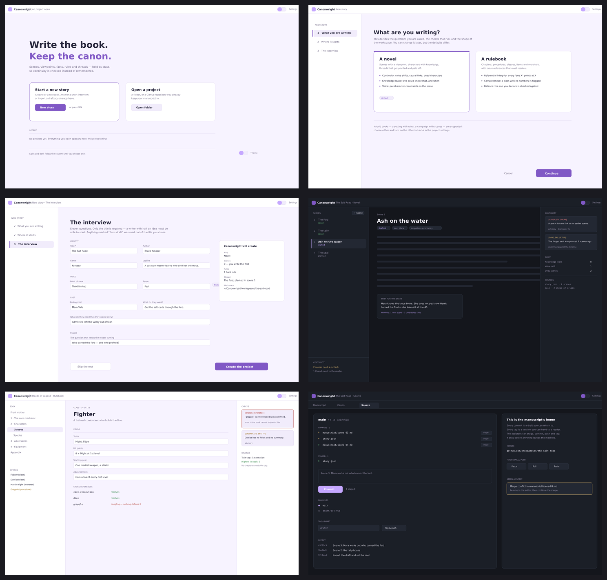

# Canonwright

**A narrative harness for long-form fiction.**

A software harness can lean on a compiler, a type checker, and a test suite to
tell you when a change is wrong. A novel has none of those. What it has is
**canon** — the accumulated, sometimes contradictory, always load-bearing truth
about who these people are, what they know, and what they have already done.

Canonwright treats that truth as a first-class, typed, temporal object instead
of as background Markdown for a retriever to sample. The harness is built in
Rust, adapted from [OpenBaD](https://github.com/bruceamoser/OpenBaD), and is
intended to run as a desktop writers' room: collaborators to think with,
reviewers that read like a linter, and editors that touch prose only when asked.

> **Status: early.** The harness core is inherited and working. The narrative
> layer — the Story State Graph — exists as a tested library and is wired into
> the tool surface. The reviewer and editor agents, the SQLite projection, and
> the desktop UI are next. This repository is not yet usable for writing.

---

## The problem

A story is not a pile of documents. Feed a model a flat RAG index of your world
bible and your chapters, and three failures follow reliably:

- **Voice drift.** The character's dialogue regresses to the model's average,
  because nothing in the prompt says *this person never uses a subordinate
  clause*.
- **Knowledge leaks.** A character acts on a fact they have not learned yet,
  because the retriever had no idea when they learned it.
- **Broken world rules.** The magic costs something in chapter two and nothing
  in chapter nineteen, because the rule was prose, and prose does not complain.

Each of these is a state problem, not a retrieval problem.

## The three properties

Everything in [`crates/canonwright-story`](crates/canonwright-story) follows
from three decisions.

**1. State is folded, not stored.**
`Story::state_before(scene)` reconstructs the world at a scene boundary by
replaying the deltas of the scenes that precede it. There is no second copy of
the truth to drift out of sync, and revising a scene's delta tells you exactly
which later scenes need a continuity pass.

**2. The future is not addressable.**
A snapshot taken before scene *N* has no representation of scene *N+1*. Scene
briefs cannot leak a later reveal, because the later reveal is not in the object
the brief was built from. Temporal isolation is a property of the type, not a
rule in a prompt that a model may ignore.

**3. Critique is evidence.**
A reviewer that says "Mara could not know that" is unfalsifiable. A ticket that
names the character, the fact, and the line is a question the harness can
settle against the timeline. Reviewers may be wrong about taste; they are not
allowed to be wrong about arithmetic.

And one policy: **nothing blocks.** Every finding is advisory. Fiction improves
by breaking its own rules on purpose, and a harness that can refuse to save a
chapter is a harness that gets uninstalled.

## What exists today

| Piece | State |
| --- | --- |
| Story State Graph: characters, factions, world rules, facts, threads, scenes | Implemented, 173 tests across three crates |
| Temporal projection (`state_before`, `state_at`, `knowledge_at`) | Implemented |
| Delta model and fold (knowledge, relationships, resources, injuries, deaths) | Implemented |
| Dirty-state propagation over the causal graph | Implemented |
| Deterministic lint (value shift, dangling setups, unearned payoffs, continuity) | Implemented |
| Evidence gate (`substantiate` a reviewer's claim) | Implemented |
| Spoiler-free scene brief renderer | Implemented |
| Manuscript import: `.md`, `.txt`, `.docx`, `.epub`, `.pdf` → drafted scenes | Implemented, 13 tests |
| Project start: blank, or imported from a draft (`story_start`) | Implemented |
| Deterministic intake: 11 questions for a new book, most of them inferred on import | Implemented, 9 tests |
| Scene writes with whole-document validation; rejected writes change nothing | Implemented |
| Canon commit and review tracking (`reviewed_against` premise digests) | Implemented |
| Agent tools: `story_intake`, `story_start`, `story_read`, `story_brief`, `story_lint`, `story_substantiate`, `story_apply`, `story_commit`, `story_review` | Wired into the `story` tool domain |
| Reviewer and editor agents | Not started |
| Story persistence in SQLite | JSON on disk for now |
| Desktop UI | Inherited from OpenBaD; not yet repurposed |

A worked example — three characters, two factions, four scenes, and a thread
that pays off — lives at
[`crates/canonwright-story/tests/fixtures/the-salt-road.json`](crates/canonwright-story/tests/fixtures/the-salt-road.json)
and is asserted against by the test suite.

## The scene pipeline

The intended loop, mirroring `plan → edit → test → review → commit`:

0. **Start** — a new manuscript, or a draft imported from `.md`, `.txt`, `.docx`,
   `.epub` or `.pdf`. An import brings the prose and the scene boundaries; it
   does not guess at the story state.
1. **Brief** — assemble the scene context from the timeline: present cast, what
   the point of view knows *at that moment*, the causal lead-in, open threads.
2. **Ideate** — optional: stress-test beats with the character and plot
   collaborators before writing.
3. **Draft** — the author writes, or generates a beat-by-beat draft.
4. **Lint** — character, plot, world, and subtext reviewers run concurrently and
   return structured tickets. Deterministic checks run without a model at all.
5. **Triage** — the author dismisses false positives and dispatches accepted
   tickets to line or pacing editors.
6. **Commit** — a state extractor proposes a delta for the finished scene; on
   approval it becomes canon, and the next scene's brief changes accordingly.

Steps 1, 4 (the deterministic half), and 6 exist as tools. Steps 2, 3, and 5 —
the collaborators, drafting, and the mutating editors — do not.

## Repository layout

```
crates/
  canonwright-story/     the Story State Graph — the product
  canonwright-manuscript/ reading .md/.txt/.docx/.epub/.pdf into scenes
  canonwright-agent/     turn/step loop, context, compaction
  canonwright-llm/       DeepSeek client, streaming, pricing
  canonwright-tools/     tool registry, schemas, built-ins, story_* tools
  canonwright-harness/   prompt sections and cache-first request envelopes
  canonwright-store/     SQLite projections, sessions, audit
  canonwright-workspace/ project manifests, policies, paths
  canonwright-governance/ risk levels, approvals, secrets policy
  canonwright-{vault,mcp,lsp,terminal,index,memory,knowledge,pipeline,...}
apps/desktop/            Tauri v2 shell and React UI
docs/                    architecture, ADRs, plans
```

## Relationship to OpenBaD

Canonwright's harness was **copied** from OpenBaD `v0.3.31` (commit `3b59840`)
with `git archive`, not forked. No git history is shared, so this repository can
diverge without constraint and OpenBaD stays a general-purpose harness. The MIT
licence and attribution are preserved in [`NOTICE`](NOTICE). See
[ADR-010](docs/adr/010-copy-openbad-core-as-a-starting-point.md).

## The screens

The product's UX is designed before it is built, in
[`design/`](design/README.md) — six screens in a FigCraft document, exported to
PNG, with both themes specified. They are a **reference for the rebuild**: the
desktop app is still the inherited shell.

[](design/README.md)

## Build & run

The desktop shell opens on the product's own screens — sign-in, the project
list, and creating a project — and only hands over to the project views once a
project is opened.

If port 5173 is in use, run the dev server elsewhere:

```sh
cd apps/desktop
./ui/node_modules/.bin/tauri dev \
  --config '{"build":{"devUrl":"http://127.0.0.1:9173","beforeDevCommand":"pnpm dev --port 9173 --strictPort"}}'
```

## Build & run

```sh
cargo check --workspace --exclude canonwright-desktop
cargo test -p canonwright-story -p canonwright-manuscript -p canonwright-tools

cd apps/desktop
pnpm --dir ui install
./ui/node_modules/.bin/tauri dev
```

[First run](docs/first-run.md) walks through importing a draft and talking to the
story tools.

The desktop app additionally needs Tauri v2 system dependencies (GTK/WebKit on
Linux) and `pnpm` for the UI.

## Roadmap

1. Split reviewers into their own crates with structured, claim-bearing output,
   and run them concurrently against a scene brief.
2. Extract story state from imported prose — cast, facts, threads, per-scene
   deltas — as a proposal a human accepts, so an existing draft gains a graph.
3. Add line editors that accept a ticket and a line range, and nothing else.
4. Project story state into SQLite so briefs are queries rather than file reads,
   and the dirty queue survives a machine.
5. Repurpose the desktop UI: a first-run prompt that asks new-or-existing, then a
   manuscript pane instead of a repository pane.
