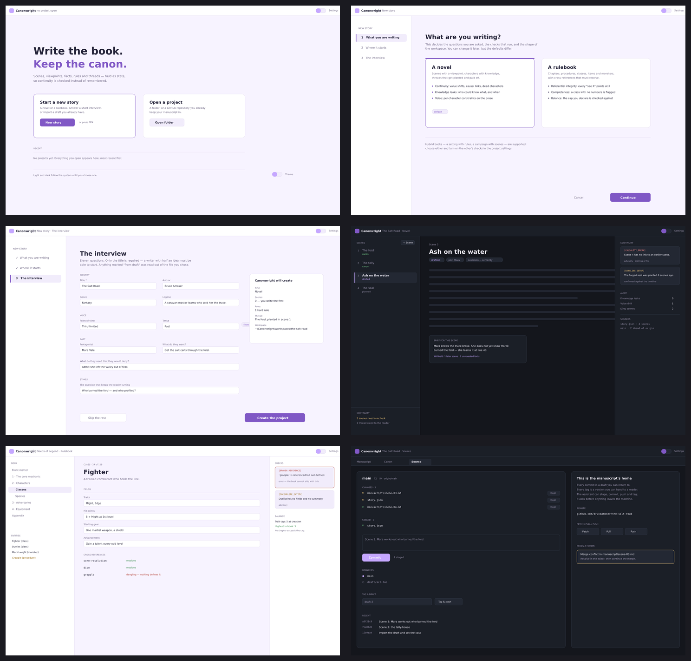

# Canonwright — UX reference

The product's screens, drawn before any of the shell was rebuilt. This is the
**reference**, not a description of what the app does today: `apps/desktop` is
still the inherited harness, and these screens are what it is being moved
towards.

Open [`index.html`](index.html) to browse them with captions, or read on.



## The set

| Screen | What it settles |
| --- | --- |
| [`01-welcome.png`](screens/01-welcome.png) | First run. No project open, nothing preselected, two doors and an empty recent list. |
| [`02-new-story---what.png`](screens/02-new-story---what.png) | Novel or rulebook, **before** anything else, because it decides the questions asked and the checks that run. |
| [`03-new-story---interview.png`](screens/03-new-story---interview.png) | The intake as a form, not a chat. Labelled fields, `from draft` badges on what the import inferred, and a live summary of what will be created. |
| [`04-workspace---novel.png`](screens/04-workspace---novel.png) | Scenes, the scene itself, and continuity side by side. Dark theme. |
| [`05-workspace---rulebook.png`](screens/05-workspace---rulebook.png) | Book tree, entity fields, cross-references with a dangling one called out. Light theme. |
| [`06-source-control.png`](screens/06-source-control.png) | Changes, staged, commit, branches, tags — and the one case that needs a human, a merge conflict. |

## The palette

Taken from the logo, so the product and the mark agree:

| | Dark | Light |
| --- | --- | --- |
| Background | `#14161C` | `#F7F3FF` |
| Surface | `#1B1F27` | `#FFFFFF` |
| Raised | `#232833` | `#F1ECFB` |
| Line | `#2E3542` | `#E2DAF0` |
| Text | `#F2EFF9` | `#25243A` |
| Muted | `#9A93AD` | `#6F6885` |
| Accent | `#C5A7FF` | `#8058C5` |

The app's tokens (`--obd-*` in `apps/desktop/ui/src/styles.css`) carry the same
roles, so a screen can be read against the CSS.

## The source, and regenerating

[`canonwright-ux.figcraft`](canonwright-ux.figcraft) is the editable document —
one page per screen. The PNGs are exports of it and the `.figcraft` file is the
source of truth; editing a PNG by hand would be undone by the next export.

```sh
python3 design/build_screens.py    # emit the command list (design/screens.json)
python3 design/build_document.py   # batch it through figcraft's MCP, save, export
```

`build_document.py` talks to `figcraft-cli mcp` over stdio through
[`figcraft_mcp.py`](figcraft_mcp.py), a ~90-line JSON-RPC client. Requires
`figcraft-cli` on `PATH`.

## Rules for changing these

- **Change the `.figcraft` file, not the code.** A layout argument costs minutes
  here and days in React.
- **Both themes are specified.** A screen that only works in dark is half a
  screen.
- **Every screen must answer "what does the writer do next?"** If a panel has
  nothing to say, it should not have width.

## Status

Reference only. Nothing in `apps/desktop` has been rebuilt against these yet;
the gap and the order of work are tracked in the [README](../README.md).
